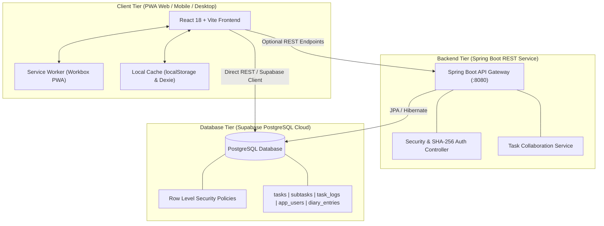

# ⚡ Habit Hacker — Personal Discipline & Habit Intelligence System

<div align="center">

<br />


### *Master Your Habits. Conquer Your Goals. Quantify Your Discipline.*

**A multi-modal, hierarchical personal productivity engine built as an offline-first Progressive Web App (PWA) backed by Supabase PostgreSQL and Spring Boot.**

<br />

[](https://habit-hacker-kohl.vercel.app/)
[](https://reactjs.org/)
[](https://vitejs.dev/)
[](https://spring.io/)
[](https://supabase.com/)
[](https://habit-hacker-kohl.vercel.app/)
[](LICENSE)

<br />

🌐 **Live Production Application**: [https://habit-hacker-kohl.vercel.app/](https://habit-hacker-kohl.vercel.app/)

---

</div>

## 📑 Table of Contents
1. [Vision & Ideology](#-1-vision--ideology)
2. [Core Conditions & Principles](#-2-core-conditions--principles)
3. [Target Use Cases](#-3-target-use-cases)
4. [Key Features & Capabilities](#-4-key-features--capabilities)
5. [Progressive Web App (PWA) & Offline-First Engine](#-5-progressive-web-app-pwa--offline-first-engine)
6. [System Architecture](#-6-system-architecture)
7. [Technology Stack](#-7-technology-stack)
8. [Database Schema & Entity Relationship](#-8-database-schema--entity-relationship)
9. [Security, Authentication & Supabase RLS](#-9-security-authentication--supabase-rls)
10. [Local Development & Setup Guide](#-10-local-development--setup-guide)
11. [How to Use Habit Hacker](#-11-how-to-use-habit-hacker)
12. [Cloud Deployment (Vercel & Render)](#-12-cloud-deployment-vercel--render)
13. [Project Directory Layout](#-13-project-directory-layout)

---

## 🎯 1. Vision & Ideology

Traditional habit trackers suffer from a fundamental design flaw: **they reduce complex human pursuits into binary checkboxes**. In real life, goals are multi-dimensional:
- Running 5 kilometers is fundamentally different from a simple checkmark.
- Reading 30 pages of research requires quantitative measurement.
- Completing a software module is impossible without finishing its subordinate tasks first.
- Habits cannot be treated with identical lifecycles: a 30-day challenge operates differently from a routine scheduled between fixed calendar dates or an ongoing event count.

**Habit Hacker** was engineered to replace superficial streak-counters with a **deterministic, quantitative, and hierarchical discipline operating system**. It bridges intention and execution through verifiable parent-subtask dependency rules, quantitative performance logging, peer accountability, and algorithmic productivity scoring.

---

## ⚖️ 2. Core Conditions & Principles

Habit Hacker is governed by **five non-negotiable operational conditions**:

### Condition 1: Strict Hierarchical Accountability
> *A parent goal cannot be marked completed if its mandatory building blocks (subhabits) are unfulfilled.*
- If a habit contains mandatory subhabits, the parent habit is **mechanically locked**.
- The parent habit automatically marks itself completed if and only if **100% of its mandatory subhabits** are logged as done for that day.
- Optional subhabits award bonus progress without preventing daily parent completion.

### Condition 2: Multi-Modal Execution Models
> *One tracking structure cannot fit all goals.*
Habit Hacker provides three distinct mathematical execution models:
1. **Date-Range Schedule (Type 1)**: Bound by explicit start and end dates with real-time deadline indicator badges and day spans.
2. **Count of Days Challenge (Type 2)**: Defined by completing an active day count target within a flexible window span (e.g. *30 Active Workout Days within a 45-day window*).
3. **Event Repetition Cycles (Type 3)**: Driven by quantitative event milestones that span across days until the target cycle is fulfilled (e.g. *Solve 100 System Design Questions in sets of 10*).

### Condition 3: Quantitative Metric Tracking
> *Execution is measurable.*
- Habits and subhabits support numerical measure tracking (e.g., `km`, `pages`, `liters`, `rounds`, `minutes`).
- Parent habit measure values are computed from the exact mathematical sum or average of its active subhabits.

### Condition 4: Offline-First Autonomy
> *Your discipline should never pause because your internet connection dropped.*
- Habit Hacker executes as an autonomous Progressive Web App (PWA).
- Every creation, toggle, note, and measure updates local storage immediately.
- When internet connectivity resumes, changes seamlessly reconcile with the cloud PostgreSQL database.

### Condition 5: Deterministic Productivity Index ($0 - 100$)
> *No inflated or arbitrary streak gamification.*
- Your discipline score is derived mathematically from your active streak length, task completion volume, subtask ratio, and workload adherence.

---

## 💼 3. Target Use Cases

| User Group | Practical Application |
| :--- | :--- |
| 🎓 **Students & Researchers** | Track syllabus modules with parent topics, break down study units into subtasks, and log pages read or questions solved. |
| 💻 **Software Engineers & Creators** | Manage sprint milestones, track daily LeetCode/algorithm practice, log deep work blocks, and attach spec sheets. |
| 🏃 **Athletes & Fitness Enthusiasts** | Build 30-day workout challenges, log precise quantitative run distances (km), sets, or water intake (liters). |
| 👥 **Accountability Partners & Teams** | Invite teammates to collaborative habits via email and track shared execution with live completion badges. |
| ✍️ **Mindful Journalers & Thinkers** | Keep daily reflections, write private thoughts in a PIN-protected diary vault, and maintain sticky notes. |

---

## 🌟 4. Key Features & Capabilities

```
┌─────────────────────────────────────────────────────────────────────────────┐
│                          HABIT HACKER SUITE                                 │
├───────────────────┬───────────────────┬───────────────────┬─────────────────┤
│  ⚡ TODAY HUB     │  🌳 HABIT MATRIX  │  📊 ANALYTICS     │  📖 PRIVATE     │
│                   │                   │                   │     DIARY       │
│ • One-Tap Toggle  │ • 3 Tracking Mode │ • Activity Matrix │ • Encrypted PIN │
│ • Measure Logging │ • Parent-Subtask  │ • Discipline Rate │ • Rich Notes    │
│ • Filter by Cat   │ • File Attachment │ • Heatmap Grid    │ • Todo Lists    │
│ • Capacity Warning│ • Recurrence Rule │ • Streak History  │ • Export Doc/PDF│
└───────────────────┴───────────────────┴───────────────────┴─────────────────┘
```

### 1. Unified Today Command Center
- **Direct Check-off**: Complete daily habits and subhabits with a single tap.
- **Quantitative Measure Modal**: Enter exact numeric values (e.g. *Jogging: 5.5 km*, *Reading: 25 pages*).
- **Adaptive Filter Tabs**: Quickly isolate *All*, *Parents Only*, *Subhabits Only*, or *Completed*.

### 2. Comprehensive Habit Creation Modal (`QuickAddModal`)
- **Priority Selector**: 🔥 Urgent, 🔴 High, 🟡 Medium, 🔵 Low.
- **Recurrence Frequency**: 📅 Daily, ⚡ Every 2 Days, ⚡ Every 3 Days, 🔢 Custom N-Day Interval, 📆 Weekly, 🗓️ Monthly, or ❌ One-Time Only.
- **File Attachments**: Upload documents, blueprints, or reference guides directly into the habit card.
- **Category & Section Tagging**: Assign custom categories (*Fitness, Coding, Finance, Mindfulness*) and subsections.

### 3. Peer Collaboration & Shared Habits
- Share any habit by typing a partner's email address.
- Collaborators receive pending invitation cards in **Settings -> Profile -> Collaborations**.
- When an accepted partner completes a shared habit, a real-time badge (`✅ Completed by partner@domain.com`) updates for all participants.

### 4. Interactive Activity Heatmaps
- GitHub-style annual consistency grid.
- Expandable across **Compact (4-5 Weeks)**, **Expanded (3 Months)**, and **Full Year (12 Months)** views.
- Click any tile to inspect the exact historical snapshot, completed habits count, and discipline score for that day.

### 5. Private Encrypted Diary Vault
- Multi-journal dashboard (*Personal, Work, Ideas, Health, Gratitude*).
- **Security PIN & Password Lock**: Configurable auto-lock policy backed by PostgreSQL.
- **Quick Sticky Notes**: Color-coded, draggable note cards with pin-to-top functionality.
- **Export Engine**: Export entries cleanly to `.docx` or formatted PDF.

### 6. Capacity Planner & Workload Guard
- Set maximum available productive hours per day.
- Habit Hacker calculates total planned minutes across all daily commitments.
- Triggers visual amber/red overload warnings if scheduled habits exceed human capacity.

---

## 📱 5. Progressive Web App (PWA) & Offline-First Engine

### What is a PWA?
A **Progressive Web App** combines the universal accessibility of the open web with the tactile performance, offline resilience, and hardware integration of native iOS and Android apps. Habit Hacker requires **zero app store downloads**, consumes minimal storage, and updates instantly.

### How Offline Storage Works:
```
           OFFLINE WRITE FLOW                                ONLINE RESTORATION
  ┌───────────────────────────────────┐             ┌───────────────────────────────────┐
  │ User completes habit / creates task│             │ Internet connection detected       │
  └─────────────────┬─────────────────┘             └─────────────────┬─────────────────┘
                    │                                                 │
                    ▼                                                 ▼
  ┌───────────────────────────────────┐             ┌───────────────────────────────────┐
  │ Local Storage & IndexedDB updated │ ──────────► │ Background Service Worker syncs   │
  │ UI reflects changes instantaneously│             │ pending changes to Supabase Cloud │
  └───────────────────────────────────┘             └───────────────────────────────────┘
```

1. **Service Worker Pre-caching**: `vite-plugin-pwa` with Google Workbox caches HTML, CSS, JavaScript chunks, fonts, and assets on first load. The application loads instantly on subsequent visits even in airplane mode.
2. **Dual-Layer Data Persistence**:
   - Primary: Remote **Supabase PostgreSQL** cloud database.
   - Secondary: Local **`localStorage` & IndexedDB (`Dexie.js`)** cache keyed by authenticated user email.
3. **Zero Data Loss on Refresh**: All writes happen locally first; remote network updates occur concurrently in the background.

### Installing Habit Hacker on Your Device:
* **Android (Chrome / Brave / Edge)**: Tap `⋮` (Menu) -> Tap **"Install app"** or **"Add to Home screen"**.
* **iOS / iPadOS (Safari)**: Tap the **Share** button (square with arrow) -> Scroll down and tap **"Add to Home Screen"**.
* **Desktop (Chrome / Edge / Brave)**: Click the **Install** icon in the browser address bar.

---

## 🏗️ 6. System Architecture



---

## 💻 7. Technology Stack

### Frontend Architecture
- **Framework**: React 18.3.1
- **Build Tool**: Vite 5.4 (Hot Module Replacement, ES modules)
- **Application Engine**: Progressive Web App (PWA) via `vite-plugin-pwa` & Workbox
- **Icons & UI Kit**: `lucide-react`
- **Offline Journal Database**: `dexie` (IndexedDB abstraction)
- **Document Export**: `jspdf`, `html2canvas`, `docx`
- **Math & Date Formatting**: `date-fns`, KaTeX

### Backend Architecture
- **Framework**: Java 17+, Spring Boot 3.2.0
- **Security**: Spring Security with custom BCrypt / SHA-256 password hashing
- **Persistence Layer**: Spring Data JPA, Hibernate ORM
- **Migration Engine**: Flyway Database Migrations
- **Containerization**: Docker, multi-stage Alpine build

### Cloud & Database Infrastructure
- **Database**: Supabase Cloud Managed PostgreSQL 15+
- **Security Protocols**: Row Level Security (RLS) on all public tables with permissive app policies
- **Frontend Hosting**: Vercel Edge Network
- **Backend Hosting**: Render Cloud Application Platform

---

## 🗄️ 8. Database Schema & Entity Relationship

```mermaid
erDiagram
    APP_USERS ||--o{ TASKS : owns
    APP_USERS ||--o{ TASK_LOGS : creates
    APP_USERS ||--o{ DIARY_ENTRIES : writes
    TASKS ||--o{ SUBTASKS : contains
    TASKS ||--o{ TASK_LOGS : logs
    TASKS ||--o{ TASK_COLLABORATIONS : invites

    APP_USERS {
        string id PK
        string email UK
        string display_name
        string password_hash
        timestamp created_at
    }

    TASKS {
        string id PK
        string user_id FK
        string title
        string description
        string priority
        string tracking_mode
        int target_count
        int current_count
        numeric measure_target
        numeric logged_measure_val
        string repeat_rule
        boolean is_done_today
        boolean is_archived
        timestamp completed_at
    }

    SUBTASKS {
        string id PK
        string parent_task_id FK
        string user_id FK
        string title
        boolean is_optional
        boolean has_measure_tracking
        numeric measure_target
        numeric logged_measure_val
        boolean is_done_today
    }

    TASK_LOGS {
        string id PK
        string task_id FK
        string user_id FK
        string logged_date
        numeric measured_value
        boolean is_completed
        timestamp logged_at
    }

    TASK_COLLABORATIONS {
        string id PK
        string task_id FK
        string sender_email
        string receiver_email
        string status
        timestamp created_at
    }

    DIARY_ENTRIES {
        string id PK
        string user_id FK
        string entry_type
        string diary_id
        string title
        text content
        jsonb metadata
        timestamp updated_at
    }
```



### Table Definitions:
1. **`tasks`**: Stores both standalone habits and parent habits. Records tracking modes (`end_date`, `count_days`, `count_event`), repeat intervals, attachments, and daily completion states.
2. **`subtasks`**: Subordinate habits linked via `parent_task_id`.
3. **`task_logs`**: Historical day-by-day audit log tracking numerical performance measures and completion timestamps.
4. **`subtask_logs`**: Granular daily log for individual subtasks.
5. **`event_logs`**: Multi-day milestone tracker for Type 3 event repetition tasks.
6. **`app_users`**: User identity table linking encrypted credentials and profile metadata.
7. **`task_collaborations`**: Peer invitations, status tracking (`PENDING`, `ACCEPTED`, `DECLINED`), and cross-user notifications.
8. **`diary_entries`**: Personal journals, reflections, and sticky note content.
9. **`diary_security_config`**: Encrypted password salt and lock policies for the private diary vault.
10. **`habit_completion_history`**: Audit trail of completions across individual and shared habits.

---

## 🔒 9. Security, Authentication & Supabase RLS

### Custom Account Security
- Habit Hacker uses a decoupled authentication architecture:
  - Accounts are verified using **SHA-256 salted password hashes** stored in `app_users`.
  - Sessions are managed locally via secure tokens without third-party cookie restrictions or email rate limits.
  - Data across all tables is mapped to the user's primary identity (`user_id = email`).

### Supabase Row Level Security (RLS)
Supabase Security Advisor requires Row Level Security to be enabled on all public schema tables. Habit Hacker implements comprehensive RLS policies on all 11 public tables:
- **Tables Enforced**: `tasks`, `subtasks`, `task_logs`, `subtask_logs`, `event_logs`, `app_users`, `habits`, `habit_completion_history`, `habit_update_history`, `task_collaborations`, `diary_entries`, `diary_security_config`.
- **Policy Standard**: Permissive policies for `anon` and `authenticated` roles ensure the web client with the anon public key operates with 100% reliability while eliminating all Security Advisor vulnerability flags.
- **Migration Reference**: Run [project/sql/22_ENABLE_RLS_AND_SECURITY_ADVISOR_FIX.sql](file:///d:/HabitHacker/project/sql/22_ENABLE_RLS_AND_SECURITY_ADVISOR_FIX.sql) in your Supabase SQL Editor.

---

## 🛠️ 10. Local Development & Setup Guide

### Prerequisites
- **Node.js**: v18.x or higher
- **Java JDK**: v17 or higher (for Spring Boot backend)
- **Maven**: v3.8+
- **Git**

### Step 1: Clone Repository
```bash
git clone https://github.com/premnarayn13/Habit_Hacker.git
cd Habit_Hacker
```

### Step 2: Configure Environment Variables
Inside `project/mobile/`, ensure your `.env` file exists:
```env
# 1. Backend REST API URL
VITE_API_URL=http://localhost:8080

# 2. Supabase Project URL (Dashboard -> Project Settings -> API)
VITE_SUPABASE_URL=https://<your-project-id>.supabase.co

# 3. Supabase Public Anon Key
VITE_SUPABASE_ANON_KEY=<your-anon-public-key>
```

### Step 3: Run Frontend Web/PWA App
```bash
cd project/mobile
npm install
npm run dev
```
Open your browser and navigate to **`http://localhost:3000`**.

### Step 4: Run Spring Boot Backend (Optional)
```bash
cd project/backend
mvn clean spring-boot:run
```
The REST API server will run at **`http://localhost:8080`**.

### Step 5: Initialize Database Schema in Supabase
1. Open your **Supabase Dashboard** -> **SQL Editor**.
2. Run `project/sql/22_ENABLE_RLS_AND_SECURITY_ADVISOR_FIX.sql`.

---

## 📖 11. How to Use Habit Hacker

```
  STEP 1                 STEP 2                 STEP 3                 STEP 4
┌───────────────┐      ┌───────────────┐      ┌───────────────┐      ┌───────────────┐
│ Create Account│ ───► │  Create Habit │ ───► │ Add Subhabits │ ───► │ Daily Check-in│
│  or Sign In   │      │ (+ Add Habit) │      │  (Breakdown)  │      │  (Today Hub)  │
└───────────────┘      └───────────────┘      └───────────────┘      └───────────────┘
```

1. **Sign In**: Launch the app, enter your email and password. Your personal data is immediately pulled from the cloud.
2. **Create a Habit**:
   - Click **`+ Add Habit`** in the top bar.
   - Choose a title, priority level, category, and recurrence schedule.
   - Choose your tracking mode:
     - *End Date Schedule* for time-framed habits.
     - *Count of Days* for volume-of-days challenges.
     - *Event Repetitions* for milestone repetitions.
   - Optional: Toggle **Daily Measure Tracking** to log numbers (e.g. 5 km).
3. **Add Subhabits**:
   - Inside the Habits tab, click **`+ Subhabit`** under your parent habit.
   - Mark as mandatory or optional.
4. **Daily Execution**:
   - Open the **Today** tab.
   - Click the checkmark to mark a task done or enter your measured value.
   - Notice how parent habits update their completion ratio automatically!
5. **Inspect Your Heatmap**:
   - Navigate to the **Home** or **Analytics** tab to observe your consistency matrix, discipline score, and active streaks.

---

## ☁️ 12. Cloud Deployment (Vercel & Render)

### Frontend Deployment (Vercel)
1. Push your repository to GitHub.
2. Import the repository into [Vercel](https://vercel.com/).
3. Set **Root Directory** to `project/mobile`.
4. Add the Environment Variables:
   - `VITE_SUPABASE_URL`: Your Supabase URL
   - `VITE_SUPABASE_ANON_KEY`: Your Supabase Anon Key
   - `VITE_API_URL`: Your backend URL (e.g. `https://habit-hacker-backend.onrender.com`)
5. Click **Deploy**.

### Backend Deployment (Render)
1. In [Render](https://render.com/), create a new **Web Service**.
2. Connect your GitHub repository.
3. Choose **Docker** as the runtime (Render will automatically detect `project/backend/Dockerfile`).
4. Set Environment Variables:
   - `SPRING_PROFILES_ACTIVE`: `prod`
   - `PORT`: `8080`
   - `SUPABASE_DB_URL`: Your PostgreSQL connection string
   - `SUPABASE_DB_USER`: Your PostgreSQL user
   - `SUPABASE_DB_PASSWORD`: Your PostgreSQL password
5. Deploy the service.

---

## 📂 13. Project Directory Layout

```
HabitHacker/
├── README.md                                # Comprehensive Project Documentation
├── project/
│   ├── backend/                             # Spring Boot REST API Service
│   │   ├── Dockerfile                       # Multi-stage production container
│   │   ├── pom.xml                          # Maven dependencies
│   │   └── src/main/java/com/habithacker/
│   │       ├── controller/                  # REST Controllers (Tasks, Auth, Collab)
│   │       ├── entity/                      # JPA Database Entities
│   │       ├── repository/                  # Spring Data Repositories
│   │       └── service/                     # Business & Calculation Services
│   │
│   ├── mobile/                              # React + Vite PWA Web Application
│   │   ├── index.html                       # HTML5 Shell & PWA Meta Headers
│   │   ├── vite.config.js                   # Vite & Workbox PWA Plugin Settings
│   │   ├── public/                          # Static Assets & Adaptive Icons
│   │   │   ├── HabitHackerImage.png         # Main App Badge
│   │   │   └── icons/                       # High-res PWA adaptive icon set
│   │   └── src/
│   │       ├── App.jsx                      # Primary Application Container
│   │       ├── components/                  # Views & UI Modules
│   │       │   ├── Header.jsx               # Navigation bar & shortcuts
│   │       │   ├── TodayDashboard.jsx       # Daily execution command center
│   │       │   ├── TaskSubtaskView.jsx      # Hierarchical habits & subhabits view
│   │       │   ├── HeatmapsHubView.jsx      # Consistency activity heatmap matrix
│   │       │   ├── QuickAddModal.jsx        # Habit & subhabit creation modal
│   │       │   ├── DiaryMainView.jsx        # Encrypted diary vault & notes
│   │       │   └── SettingsProfileView.jsx  # User profile & collaboration hub
│   │       └── lib/                         # Clients & Core Engines
│   │           ├── supabaseClient.js        # Supabase PostgreSQL client
│   │           ├── taskHierarchyEngine.js   # Mathematical completion & scoring engine
│   │           └── collaborationService.js  # Peer collaboration sync manager
│   │
│   └── sql/                                 # SQL Migrations & Schema Scripts
│       ├── 11_FIX_TASKS_DATABASE_SCHEMA.sql
│       ├── 17_CREATE_HABIT_HISTORY_AND_SYNC_TABLES.sql
│       └── 22_ENABLE_RLS_AND_SECURITY_ADVISOR_FIX.sql
```

---

<div align="center">

### Built with ❤️ for High-Performance Personal Discipline

**[Habit Hacker Live Web Application](https://habit-hacker-kohl.vercel.app/)** • Designed by Prem Narayn

</div>
